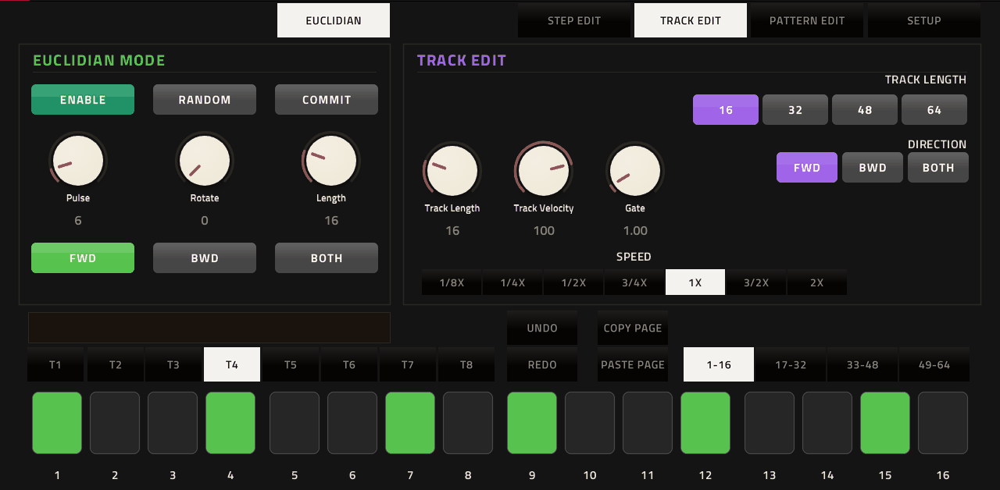

# StepRunner-8

An 8-track, 64-step sequencer for Akai MPC standalone (tested on an MPC Live with MPC OS 3.9; 32-bit ARM), loaded as a
VST2 plugin by MPC's own plugin host, with a native MPC screen skin. It does not make sound: it sends
MIDI to other tracks (typically a drum program), with step conditions and step and CC locks.



## Demo video

A short demo, and how to map StepRunner-8 to a drum program:

[](https://youtu.be/jZ22XHM5tb0)

## Features

- 8 tracks × 64 steps (4 pages of 16), notes 36–43 = pads A01–A08 of a drum program by default
- Per track: length, speed (1/8x … 2x), direction (FWD / BWD / BOTH), MIDI channel, note, velocity, gate, mute
- Per step: step conditions (1ST, A:B, FILL, PRE, NEI …), probability, velocity / length / pan locks, five CC locks,
  micro-timing and ratchets
- Euclidean generator per track, random generators for trigs and every lock
- 8 patterns (cue the next one while playing), pattern length, shuffle, copy / paste of steps, pages, tracks and patterns
- PERFORM tab: mutes, live effects (loops, fill, humanize, build, echo, ghost notes, fade out …), PERFORM ALL
  offsets and 8 STATE slots per pattern that recall the whole sequencer
- CC locks go back to the pad's own value after the locked step (base values)
- CREATE DEFAULT MAP writes MIDI Learn mappings for the CC locks into your saved MPC project, so the CC knobs drive the
  pads of a drum program without mapping each one by hand
- Undo / redo

## Manual

The full user manual with screenshots is in [docs/MANUAL.md](docs/MANUAL.md).

## Install

Download `StepRunner-8-<version>-mpc-armv7.zip` from [Releases](../../releases) and follow `INSTALL.md` inside the
zip (it runs `install.sh` on the device as root over SSH; it backs up `MPC.settings` first).

## Demo projects

`StepRunner-8-demo-projects.zip` on the [Releases](../../releases) page holds two MPC projects, already mapped with
CREATE DEFAULT MAP:

- **DEMO - Drum Synth - empty**: StepRunner-8 driving MPC's Drum Synth.
- **DEMO - Drum Track - empty**: StepRunner-8 driving an empty Drum Track; load your own samples on pads A01–A08.

Unzip, copy the `.xpj` files to your MPC and open one.

## Quick start

1. Load StepRunner-8 on a plugin track.
2. Make a drum track with your drum program. Set its MIDI input to the port **StepRunner-8**
   (enable the port as a Track input in Preferences → MIDI if it is not listed).
3. Press play on the MPC: StepRunner-8 follows the MPC's tempo and transport.
4. For CC locks on drum pads: save the project, open SETUP → CREATE DEFAULT MAP, pick the drum track, then close and
   reopen the project as the message says. Saving the project as a new name first is recommended.

## Build from source

Needs Docker and a checkout of [mpc-vst-plugins](https://github.com/sd88me/mpc-vst-plugins) (its tools):

```sh
MPC_VST=/path/to/mpc-vst-plugins ./test.sh      # offline test (x86, ASan), must print PASSED
MPC_VST=/path/to/mpc-vst-plugins ./build.sh     # build/steprunner8.so and the skin
MPC_VST=/path/to/mpc-vst-plugins ./release.sh   # dist/StepRunner-8-<version>-mpc-armv7.zip
```

Or let GitHub build it: Actions → Release → Run workflow (see `.github/workflows/release.yml`).
Developer notes are in `PROJECT_NOTES.md`; the history (it started as "Trig Seq") is in `PROJECT_HISTORY.md`.

## License

MIT, see [LICENSE](LICENSE). Community software, not affiliated with or endorsed by Akai Professional.
