# StepRunner-8 — User Manual

Version 1.2.0 · [Demo and mapping video on YouTube](https://youtu.be/jZ22XHM5tb0)

StepRunner-8 is an 8-track, 64-step sequencer for Akai MPC standalone, loaded as a plugin on a plugin track. It makes
no sound of its own: it sends MIDI to other tracks, usually a drum program. Each step can have a condition, a
probability and its own values ("locks") for velocity, length, pan and five CCs.

**Contents**

1. [Installation and first setup](#1-installation-and-first-setup)
2. [The screen](#2-the-screen)
3. [SETUP](#3-setup)
4. [PATTERN EDIT](#4-pattern-edit)
5. [TRACK EDIT](#5-track-edit)
6. [STEP EDIT](#6-step-edit)
7. [TIMING](#7-timing)
8. [EUCLIDIAN](#8-euclidian)
9. [Random and clear buttons](#9-random-and-clear-buttons)
10. [Step conditions](#10-step-conditions)
11. [The PERFORM tab](#11-the-perform-tab)
12. [MIDI details](#12-midi-details)
13. [Undo, saving and limits](#13-undo-saving-and-limits)

---

## 1. Installation and first setup

### Install

1. Download `StepRunner-8-<version>-mpc-armv7.zip` from the [Releases](https://github.com/djokenzi/steprunner-8/releases) page.
2. Follow `INSTALL.md` inside the zip. It copies the plugin to the MPC and adds it to the plugin list
   (it backs up `MPC.settings` first and restarts MPC).

### Connect it to a drum program

1. Create a **plugin track** and load **StepRunner-8** on it.
2. Create a **drum track** with your drum program.
3. Set the drum track's **MIDI input** to the port **StepRunner-8**. If the port is not listed, enable it as a
   Track input in *Preferences → MIDI*.
4. Press **PLAY** on the MPC. StepRunner-8 follows the MPC's tempo and transport.

By default the eight tracks play notes **36–43** on MIDI channel **1**, which are pads **A01–A08** of a drum program:
T1 plays A01, T2 plays A02, and so on.

### Getting the CC locks onto the pads

The CC locks only do something once the MPC knows which pad parameter each CC controls. **CREATE DEFAULT MAP**
(in SETUP, see [3.4](#34-create-default-map)) writes those mappings into your saved project for you.

---

## 2. The screen

StepRunner-8 has two tabs at the bottom of the plugin screen: **PROGRAM** (programming) and **PERFORM** (playing live).

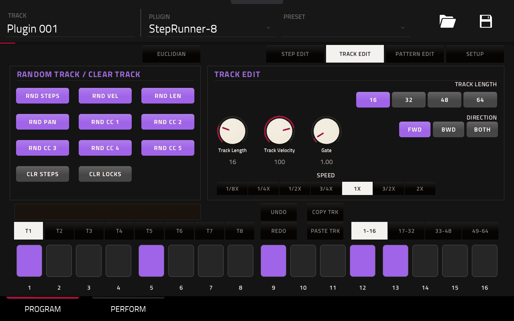

### Mode buttons

Along the top are the mode buttons: **STEP EDIT**, **TRACK EDIT**, **PATTERN EDIT** and **SETUP**.

- One of the four is always lit. Tapping the lit one does nothing.
- A new StepRunner-8 opens on **SETUP**. A saved project opens on the screen it was saved on.
- The slot on the left of the mode buttons holds a fifth button:
  - **TIMING** in STEP EDIT;
  - **EUCLIDIAN** in TRACK EDIT;
  - nothing in PATTERN EDIT and SETUP.
- The two arrow buttons **◀ ▶** on the far left of the top row are shown in every mode. In PATTERN EDIT, TRACK EDIT and
  STEP EDIT they switch the left section between its two pages (see [TRACK EDIT](#5-track-edit)). Each mode keeps
  its own page. In the other modes they do nothing yet.

### Left section and right panel

- The **left section** holds the random/clear buttons, or the TIMING or EUCLIDIAN tools.
- The **right panel** shows the settings of the current mode.
- Each mode has its own colour: **orange** for PATTERN EDIT and SETUP, **violet** for TRACK EDIT, **teal** for STEP EDIT
  and TIMING, and **green** for EUCLIDIAN.

### Bottom area

| Control | What it does |
|---|---|
| Message strip | Short messages, e.g. *Copied 2 steps*, *Pattern 3 Cued* |
| **T1 … T8** | Select the track you are editing |
| **1-16 … 49-64** | Select which 16 of the 64 steps are shown. A thin bar on a page button shows where the selected track is playing. The page does not follow the play-head. |
| **UNDO / REDO** | Undo and redo (see [13](#13-undo-saving-and-limits)) |
| **COPY / PASTE** | Copies and pastes what fits the mode: steps (STEP EDIT), a track (TRACK EDIT) or a page (PATTERN EDIT). Hidden in SETUP. |
| **SHIFT** | STEP EDIT only: select several steps |
| Step cells 1–16 | The 16 steps of the shown page |

### Step cells

| Look | Meaning |
|---|---|
| Dark | Empty step |
| Filled with the mode colour | Step with a trig |
| Green | Track generated by EUCLIDIAN (green in every mode) |
| Lighter cell with a white bar on top | Play-head (only while playing, on the page where the track is) |
| Red outline | Selected step (STEP EDIT and TIMING) |

Tapping a cell **toggles the trig** in PATTERN EDIT, TRACK EDIT, SETUP and EUCLIDIAN. In STEP EDIT and TIMING a tap only
**selects** the step and never changes the trig.

---

## 3. SETUP

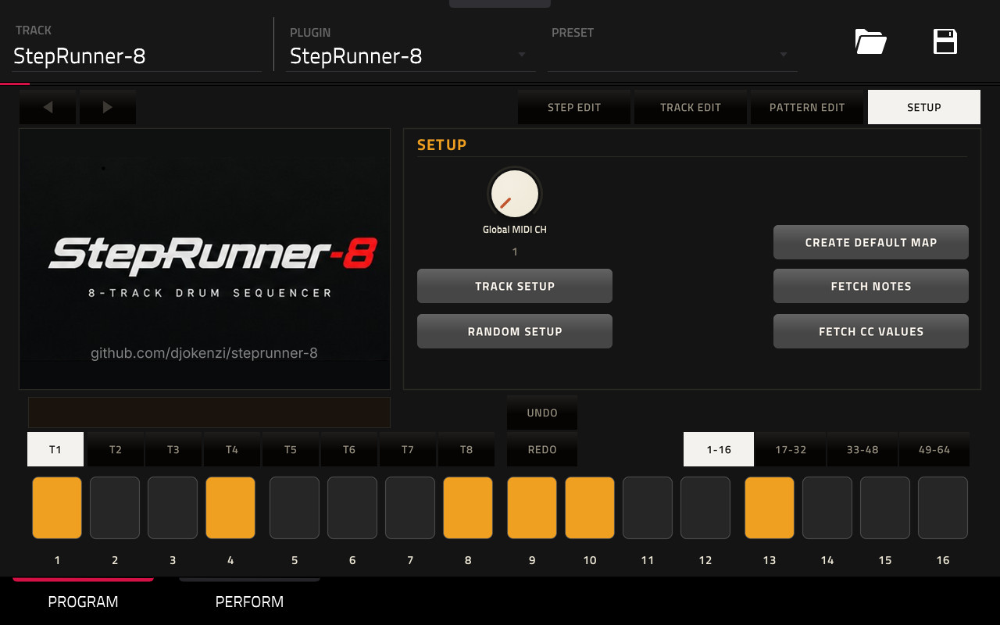

| Control | What it does |
|---|---|
| **Global MIDI CH** | Sets the MIDI channel of all 8 tracks at once (1–16). Shows *MIXED* if the tracks differ. |
| **TRACK SETUP** | Channel, note and CC numbers of the selected track ([3.1](#31-track-setup)) |
| **RANDOM SETUP** | Settings of the random generators of the selected track ([3.2](#32-random-setup)) |
| **CREATE DEFAULT MAP** | Writes MIDI Learn mappings into the saved project ([3.4](#34-create-default-map)) |
| **FETCH NOTES** | Reads the pad notes from the saved project ([3.3](#33-fetch-notes-and-fetch-cc-values)) |
| **FETCH CC VALUES** | Reads the pads' current values from the saved project ([3.3](#33-fetch-notes-and-fetch-cc-values)) |

The left side of the SETUP screens shows the StepRunner-8 logo; the random and clear buttons are not shown here.

### 3.1 TRACK SETUP

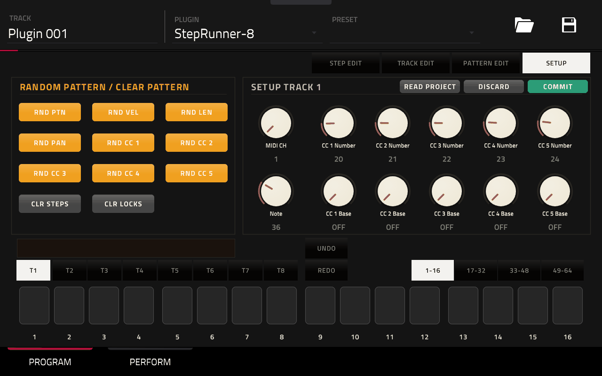

The settings of the selected track (the title shows *SETUP TRACK n*):

| Knob | Range | Meaning |
|---|---|---|
| **MIDI CH** | 1–16 | Channel the track sends on |
| **Note** | 0–127 | Note the track plays |
| **CC 1–5 Number** | 0–127 | CC number each of the five CC locks is sent on |
| **CC 1–5 Base** | OFF, 0–127 | The value the CC goes back to after a locked step (see [12.3](#123-base-values)) |

- **MIDI CH** and **Note** take effect immediately.
- The CC numbers and base values are a draft: **COMMIT** applies them, **DISCARD** throws them away. Selecting another
  track (T1–T8) drops the draft and starts again from that track.
- **READ PROJECT** fills the base values from the saved project. Each base becomes the current value of the pad
  parameter that its CC is mapped to. Press COMMIT afterwards to keep them.

### 3.2 RANDOM SETUP

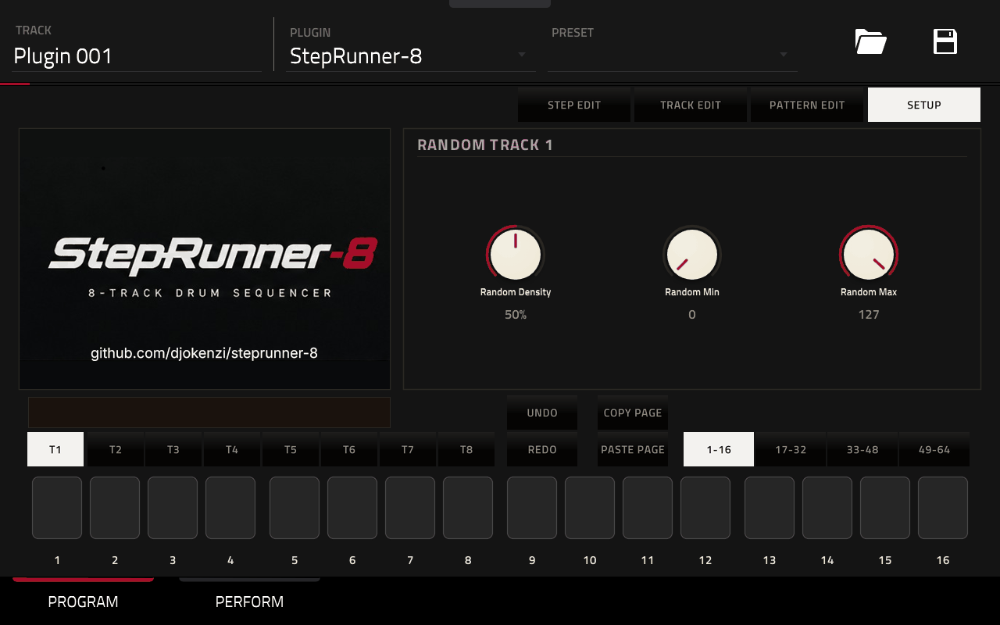

Each track has its own settings for the random generators (the title shows *RANDOM TRACK n*; switch tracks with T1–T8):

- **Random Density** (0–100 %, default 50 %): how many steps get a trig, or how many trigs get a new value.
- **Random Min / Random Max** (0–127): the range of the random values.

Tap **SETUP** to go back to the SETUP panel.

### 3.3 FETCH NOTES and FETCH CC VALUES

Both read the **saved** project file and change only StepRunner-8:

- **FETCH CC VALUES**: for all 8 tracks, each CC that is mapped to a pad parameter gets that parameter's current
  value as its base value. The pad's pan is read too. Message: *Read n CC values*.
- **FETCH NOTES**: each track whose CCs are mapped to a pad gets that pad's note. Use it if your pads do not use notes
  36–43. Message: *Read n notes*.

The project must be **saved with StepRunner-8 in it**. Otherwise you see *Save the project first* or
*No saved project found*. Changes you made in the MPC after saving are not seen until you save again.

### 3.4 CREATE DEFAULT MAP

Use this to map the CC locks to the pads of a drum program automatically. The steps are also shown in the
[demo and mapping video](https://youtu.be/jZ22XHM5tb0).

1. **Save the project.** Saving it under a new name is recommended, rather than overwriting your existing project.
2. Tap **CREATE DEFAULT MAP**.
   - If the project is not saved, you see **PROJECT NOT SAVED**.
   - If there are several saved copies, StepRunner-8 asks *Which project is open?* Mark the open one and tap COMMIT.
   - If the project has no drum track, you see **NO DRUM TRACK**.
3. A list of the project's drum tracks appears. Tap the drum track to map to (it turns orange) and tap **COMMIT**.
   **CANCEL** closes the list without changing anything.
4. For every track, StepRunner-8 maps track *n* to pad *A0n* of that drum track:

   | StepRunner-8 | Pad parameter |
   |---|---|
   | CC 1 | Tuning |
   | CC 2 | Filter Cutoff |
   | CC 3 | Filter Resonance |
   | CC 4 | Send 1 |
   | CC 5 | Send 2 |
   | Pan | Pad Pan |

   A CC or pad parameter that is already mapped is left alone.
5. The message **n VALUES MAPPED** asks you to **close the project and open it again without saving it first**.
   Saving first would overwrite the new mappings with the MPC's old ones.

The chosen drum track is remembered and used by READ PROJECT, FETCH CC VALUES and FETCH NOTES.

---

## 4. PATTERN EDIT

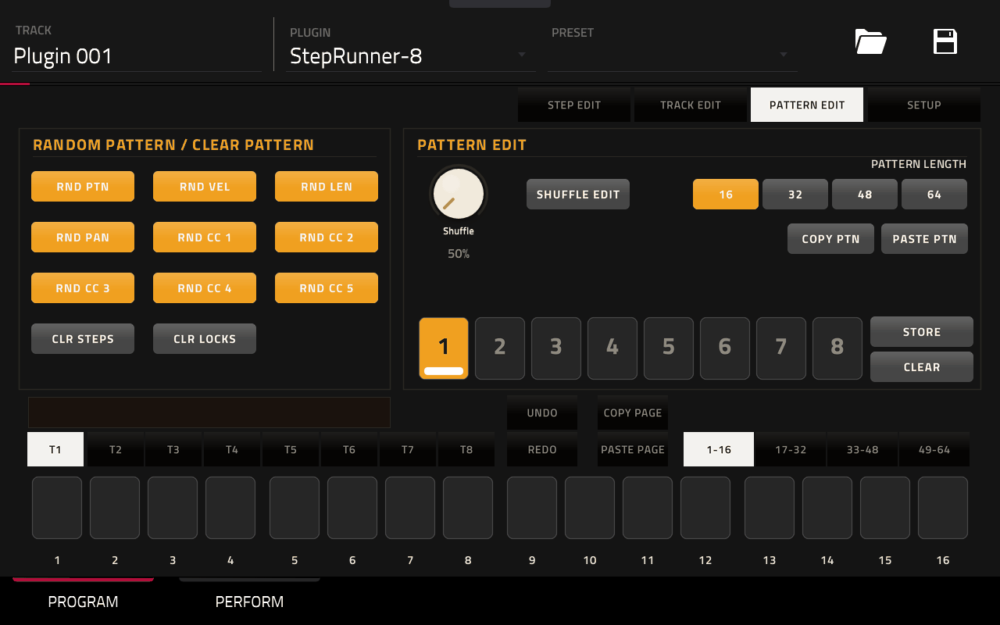

PATTERN EDIT holds the settings of the whole pattern:

- **Shuffle** (50–80 %): delays every second step. 50 % is straight; about 66 % gives a triplet feel.
- **SHUFFLE EDIT**: shows the buttons T1–T8 and ALL. Only lit tracks follow the shuffle; all of them do by default.
- **PATTERN LENGTH 16 / 32 / 48 / 64**: sets the length of all 8 tracks. When tracks get longer, their existing
  pages are copied onto the new, empty pages. Pages that already hold trigs are never overwritten.
- **COPY PTN / PASTE PTN**: copy the playing pattern and paste it over the playing pattern. Its eight states go along
  and replace the states of the pattern you paste into.
- In PATTERN EDIT the random buttons act on **all 8 tracks**. CLR STEPS and CLR LOCKS still clear only the selected
  track.
- **▶ / ◀** switch to the second page of random buttons and back: **RND COND / RND TIMING / RND RATCHETS**, as in
  [TRACK EDIT](#5-track-edit), but on every trig of **all 8 tracks**. With CLR LOCKS lit, **CLR COND / CLR TIMING /
  CLR RATCHETS** also clear all 8 tracks (unlike CLR VEL … CLR CC 5 on page 1, which clear the selected track).

### Patterns 1–8

StepRunner-8 holds 8 patterns. A pattern is everything about the 8 tracks: steps, locks and track settings, plus the
shuffle. Every pattern also has its own eight states (see PERFORM). Mutes and the PERFORM pads are not part of a
pattern.

| Pattern button | Meaning |
|---|---|
| Orange with a bar | Playing (blinks with the beat while the MPC plays) |
| Pale | Holds a pattern |
| Dark | Empty |
| Pale with a grey bar | Cued: comes in next |

How to use the pattern buttons:

- **Tap a pattern while stopped:** it loads immediately.
- **Tap a pattern while playing:** it is **cued** and comes in when the playing pattern reaches its end. Tap it again
  to cancel the cue.
- **STORE + tap a pattern:** saves what is playing into that slot, together with its states.
- **CLEAR + tap a pattern:** empties it and deletes its states. STORE and CLEAR stay lit until you tap them again.
- **Editing** always changes the pattern that is playing.

---

## 5. TRACK EDIT

The settings of the selected track:

| Control | Range | Meaning |
|---|---|---|
| **TRACK LENGTH 16 / 32 / 48 / 64** | | Quick length buttons (with the same page copying as PATTERN LENGTH) |
| **Track Length** | 1–64 | Any length, e.g. 13 for a polymetric track |
| **TRACK VALUES** | | Opens the track's values (below) |
| **DIRECTION** | FWD, BWD, BOTH | Forwards, backwards, or back and forth |
| **SPEED** | 1/8X … 2X | 1X = 16th notes, 2X = 32nds, 1/2X = 8ths … |

**TRACK VALUES** shows the knobs of STEP LOCKS in the same places, but for the whole track. **BACK** (where CONDITION
is on STEP LOCKS) returns to TRACK EDIT. The panel stays open when you switch modes and come back.

| Knob | Range | Meaning |
|---|---|---|
| **Velocity** | 1–127 | Velocity of trigs without a velocity lock |
| **Pan** | L64 … C … R63 | The pad's pan (sent at once); trigs without a pan lock return to it. `--` = not known yet (see FETCH CC VALUES) |
| **Length** | 0.25–16 steps | Note length of trigs without a length lock |
| **Prob** | 0–100 % | Chance of every trig of the track, on top of each step's own probability. NO LOCKS ignores it. |
| **CC 1–5** | 0–127 | The CC's base value (sent at once); a CC lock returns to it, as in [12.3](#123-base-values). `--` = none |

The random buttons act on the selected track. **▶** shows a second page of random buttons, **◀** goes back to the
first. The page stays as it is when you switch modes.

| Page 2 button | Writes, on every trig of the selected track |
|---|---|
| **RND COND** | A random condition (any in the list, "--" included) |
| **RND TIMING** | A random timing offset (up to ±23/24 of a step) |
| **RND RATCHETS** | A random number of hits (1–8) and Ratchet Resolution (AUTO with one hit) |

Page 2 ignores *Random Density*: every trig gets a new value. Steps without a trig are not changed. CLR STEPS and
CLR LOCKS stay on page 2. With CLR LOCKS lit the buttons read **CLR COND / CLR TIMING / CLR RATCHETS** and clear that
setting from the whole track.

**COPY TRK / PASTE TRK** copy a whole track, keeping the target
track's channel, note and CC numbers.

---

## 6. STEP EDIT

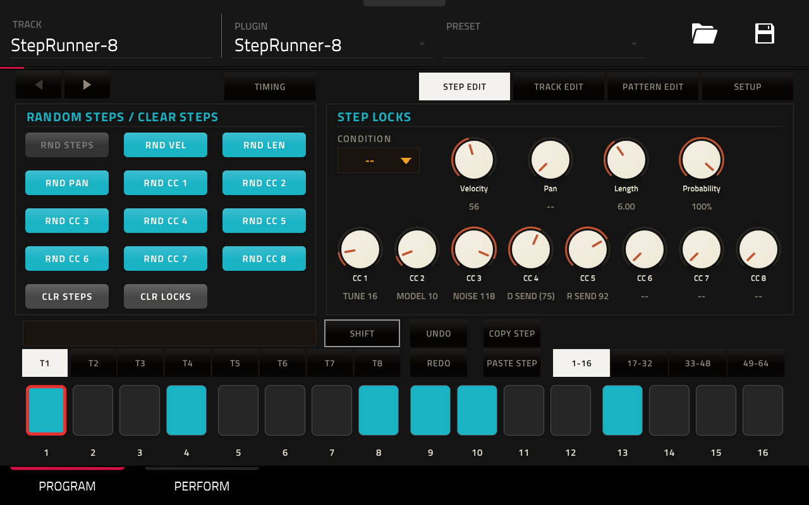

STEP EDIT sets the **locks** of individual steps.

**Selecting steps:**

- Tap a step to select it (red outline). In STEP EDIT a tap never adds or removes a trig; do that in TRACK EDIT or
  PATTERN EDIT.
- With **SHIFT** lit, taps add steps to the selection or remove them. With several steps selected, every knob writes
  to all of them.

**STEP LOCKS** (`--` means no lock):

| Control | Values | Without a lock |
|---|---|---|
| **CONDITION** | see [10](#10-step-conditions) | always plays |
| **Velocity** | 1–127 | track velocity |
| **Pan** | L64 … C … R63 | nothing sent |
| **Length** | 0.25–16 steps | track gate |
| **Probability** | 0–100 % | 100 % |
| **CC 1–5** | 0–127 | nothing sent (or the base value, see [12.3](#123-base-values)) |

- If a CC has a base value, a step without a lock shows it in brackets, e.g. *(64)*.
- Turn a CC knob fully down to `--` to remove its lock.

**▶ / ◀** switch the left section to a second page and back: **RND COND / RND TIMING / RND RATCHETS**, as in
[TRACK EDIT](#5-track-edit), but on the **selected steps** only, with or without a trig (like the other RND buttons in
STEP EDIT). With CLR LOCKS lit, **CLR COND / CLR TIMING / CLR RATCHETS** clear the selected steps.

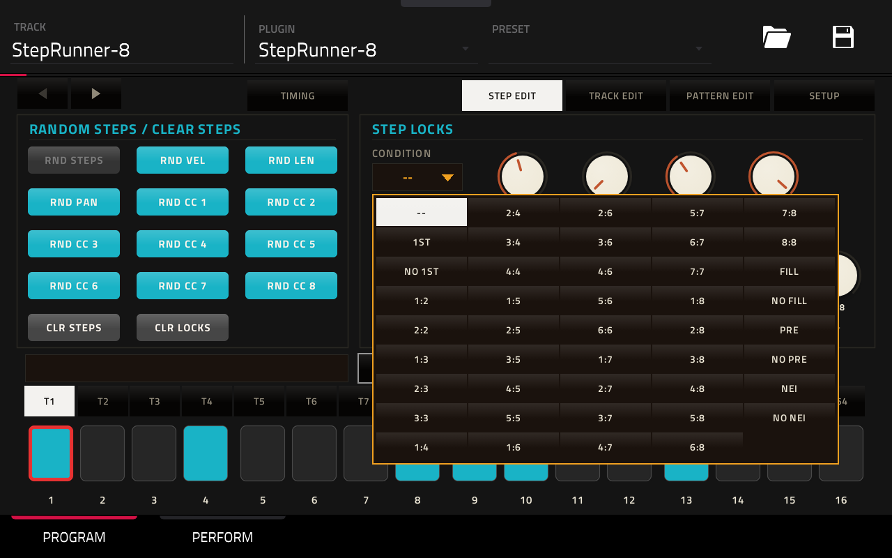

**COPY STEP / PASTE STEP:**

- COPY STEP copies the selected steps, including everything on them and the spacing between them.
- PASTE STEP writes them starting at the selected step, also onto another track or page.

---

## 7. TIMING

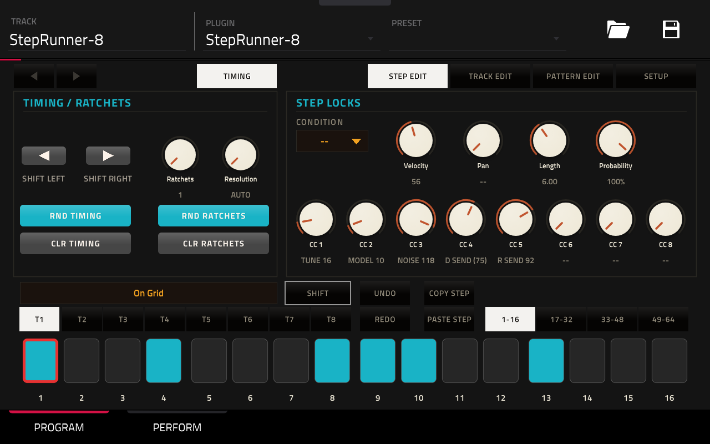

Tap **TIMING** in STEP EDIT. Steps are selected exactly as in STEP EDIT, and the STEP LOCKS stay on the right.

| Control | What it does |
|---|---|
| **◀ SHIFT LEFT / SHIFT RIGHT ▶** | Moves the selected steps 1/24 of a step earlier or later (up to ±23/24) |
| **Ratchet** | 1–8 hits on the step |
| **Ratchet Resolution** | AUTO spreads the hits over the step. 1/16 … 1/80 give a fixed spacing (1–5 hits per step); extra hits continue over the following steps. |
| **RND TIMING / RND RATCHETS** | Random offset / random number of hits and Ratchet Resolution on the selected steps (one hit: AUTO) |
| **CLR TIMING / CLR RATCHETS** | Back on the grid / back to one hit |

Tap **TIMING** again to go back to STEP EDIT.

---

## 8. EUCLIDIAN

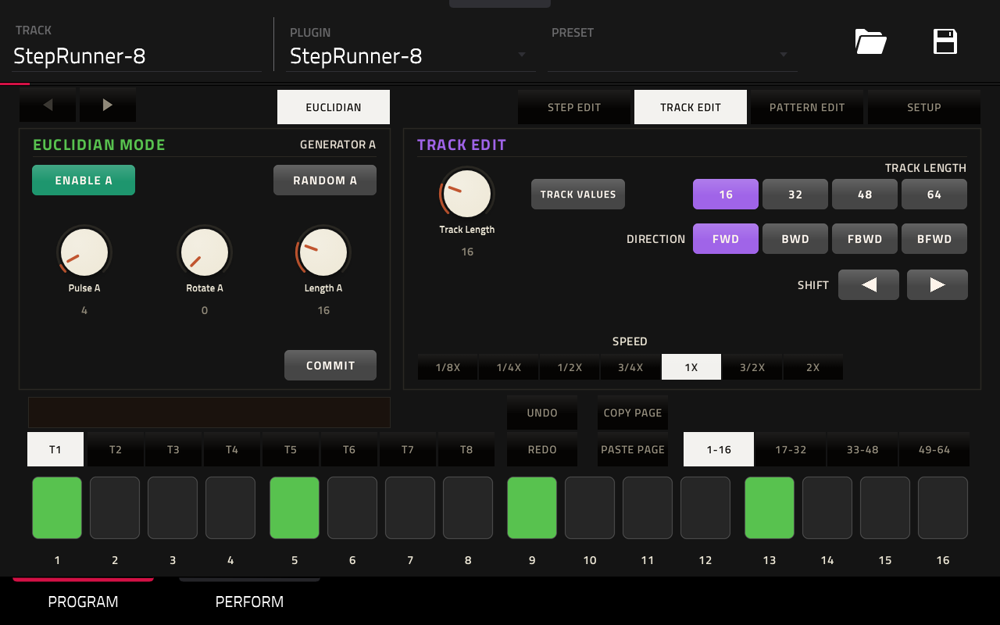

Tap **EUCLIDIAN** in TRACK EDIT. It generates evenly spread rhythms on the selected track, with two generators:
**A** (top row) and **B** (bottom row). Each has the same controls:

| Control | What it does |
|---|---|
| **ENABLE A / B** | On: that generator writes the track's trigs (cells turn green). With both off, your previous trigs come back. |
| **Pulse A / B** | Number of hits (0–64) |
| **Rotate A / B** | Shifts that rhythm by steps |
| **Length A / B** | Length of that rhythm (1–64). It repeats over the track; if it is longer than the track, the track plays the rhythm's length. |
| **RANDOM A / B** | Random length, pulses and rotation for that generator; switches it on. The other generator is left as it is. |
| **▶ / ◀ / ◀▶** | How that generator runs through its rhythm: forwards, backwards, or back and forth (while it is on). The track itself keeps the direction set in TRACK EDIT. |

When both generators are on, the bottom row decides what happens to the steps (dim while only one is on):

| Button | A step gets a trig when… |
|---|---|
| **XOR** | exactly one of the two has a hit there |
| **OR** | A or B (or both) has a hit there |
| **AND** | both have a hit there |
| **SUB** | A has a hit there and B does not |

**COMMIT** keeps the generated trigs as normal trigs and leaves EUCLIDIAN.

Step conditions and locks stay as they are; only the trigs are generated. If you leave EUCLIDIAN without COMMIT, the
generators keep running on that track (green cells) and is saved with the project. Tap EUCLIDIAN or TRACK EDIT to leave.

---

## 9. Random and clear buttons

The left section on the PROGRAM tab holds the random and clear buttons:

| Button | Writes |
|---|---|
| **RND PTN / RND STEPS** | New trigs: each step gets a trig with the probability *Random Density* |
| **RND VEL** | Velocity locks |
| **RND LEN** | Length locks |
| **RND PAN** | Pan locks |
| **RND CC 1–5** | Locks of that CC |

The values come from *Random Min … Max* in RANDOM SETUP. What the buttons act on depends on the mode:

| Mode | Acts on |
|---|---|
| PATTERN EDIT | All 8 tracks, each with its own random settings |
| TRACK EDIT | The selected track |
| STEP EDIT | Only the selected steps (RND STEPS is off) |

In PATTERN EDIT and TRACK EDIT the lock buttons change only *Random Density* % of the steps that have a trig.

- **CLR STEPS**: empties the selected track (trigs, conditions, locks, timing). Its settings stay.
- **CLR LOCKS**: a switch. While it is lit (red), the buttons turn into CLR VEL, CLR LEN, CLR PAN and CLR CC 1–5.
  Each removes that lock from the selected steps (STEP EDIT) or from the whole selected track (other modes). Tap
  CLR LOCKS again to switch it off.

---

## 10. Step conditions

A step with a condition plays only when the condition is true. After that, its probability is rolled.

| Condition | Plays … |
|---|---|
| `--` | always |
| **1ST** | only the first time through the track |
| **NO 1ST** | every time except the first |
| **A:B** (1:2 … 8:8) | on the A-th time of every B times. Example: 2:4 plays on the 2nd, 6th, 10th … time through the track. |
| **FILL / NO FILL** | while the **FILL** pad (PERFORM tab) is on / off |
| **PRE / NO PRE** | if the last conditional step of the same track played / did not play |
| **NEI / NO NEI** | if the last conditional step of the previous track (T1 for T2, and so on) played / did not play |

- Each track counts its own repeats, by its own length, starting from the beginning of the MPC sequence.
- A "conditional step" is one with a condition (other than PRE/NEI) or a probability below 100 %.

---

## 11. The PERFORM tab

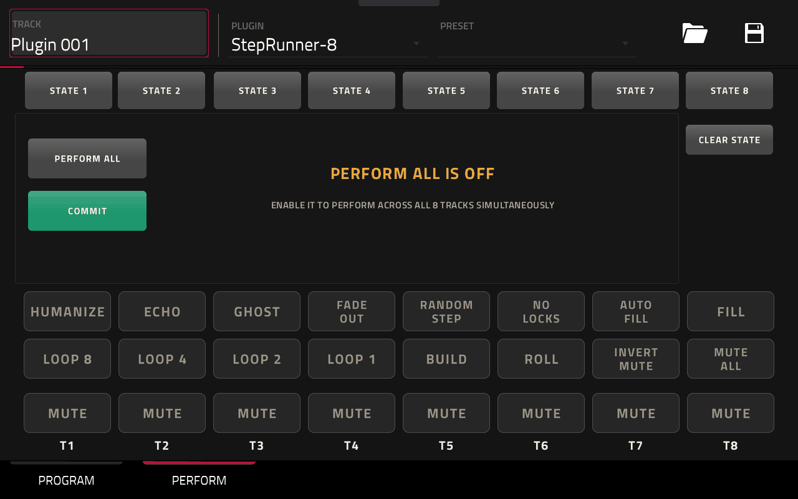

### Effect pads

The effect pads act on all 8 tracks and are violet while on.

| Pad | Effect |
|---|---|
| **STOP CC** | No CC messages go out while it is on (CC locks, base values, pan, PERFORM ALL); notes keep playing. Switched off, every track sends its base values and pan again on its next step. |
| **ECHO** | Every note repeats 3 times, an 8th note apart, getting quieter |
| **GHOST** | Every empty step plays a quiet ghost note |
| **FADE OUT** | Fades all tracks to silence over one bar |
| **RANDOM STEP** | Every track plays random steps |
| **NO LOCKS** | Plays the trigs without conditions, probability, locks, timing or ratchets |
| **AUTO FILL** | Adds random extra hits in the last 4 steps of each track |
| **FILL** | Switches the FILL condition on |
| **LOOP 8 / 4 / 2 / 1** | Every track repeats the last 8 / 4 / 2 / 1 steps it played. Switching off drops back to where it would have been. |
| **BUILD** | Hits multiply (one more every beat, up to 8) and velocity rises |
| **ROLL** | Every trig plays at least 4 hits |
| **INVERT MUTE** | Flips all mutes; off flips them back |
| **MUTE ALL / UNMUTE ALL** | Mutes all tracks, or unmutes all if any is muted |
| **MUTE T1–T8** | Mute a single track (red when muted) |

### PERFORM ALL

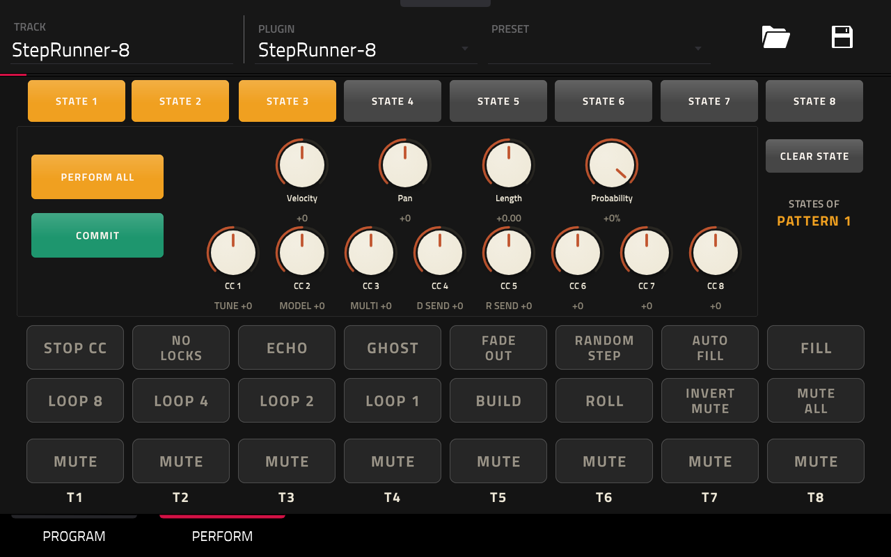

**PERFORM ALL** turns the knobs into offsets for all 8 tracks at once:

| Knob | What it changes |
|---|---|
| **Velocity** | Each track's velocity |
| **Pan** | Pan of steps without a pan lock |
| **Length** | Each track's gate |
| **Probability** | Lowers the probability of plain steps (100 %, no condition) |
| **CC 1–5** | Moves each track's base value of that CC (only tracks with a base value) |

Locks are never changed: they still play on their steps.

- Switching **PERFORM ALL off** without COMMIT puts everything back as it was when you switched it on, including edits
  you made in the meantime.
- **COMMIT** keeps what you hear: the offsets are written into the pattern and PERFORM ALL switches off.

### STATES 1–8

- **Tap an empty STATE:** saves a snapshot of the whole sequencer into it: the playing pattern, shuffle, mutes,
  PERFORM ALL with its knobs, and the effect pads. The button turns orange.
- **Tap a full STATE:** recalls the snapshot instantly while the music keeps playing. A white frame marks the state used
  last.
- **Every pattern has its own eight states.** The buttons always show the states of the pattern that is playing; the
  text under CLEAR STATE says which one (*STATES OF PATTERN 3*). When another pattern comes in, the buttons switch to
  its states. A state is recalled into its own pattern, so it never overwrites another pattern.
- **CLEAR STATE + tap a state:** empties it.

---

## 12. MIDI details

### 12.1 Defaults

| Track | Note (pad) | CC 1–5 | Pan CC |
|---|---|---|---|
| T1 | 36 (A01) | 20–24 | 30 |
| T2 | 37 (A02) | 25–29 | 31 |
| T3 | 38 (A03) | 85–89 | 90 |
| T4 | 39 (A04) | 102–106 | 117 |
| T5 | 40 (A05) | 107–111 | 118 |
| T6 | 41 (A06) | 112–116 | 119 |
| T7 | 42 (A07) | 14–18 | 3 |
| T8 | 43 (A08) | 80–84 | 9 |

All tracks start on MIDI channel 1 with velocity 100, gate 1 step, length 16 and speed 1X.

### 12.2 What is sent

When a step plays, StepRunner-8 sends, in this order:

1. the step's CC locks;
2. its pan lock;
3. the note (Note Off follows after the length).

A step without locks sends only the note.

The MIDI port is **StepRunner-8**. A second StepRunner-8 in the same project uses the port **StepRunner-8 2**, and so on.

### 12.3 Base values

- **Base OFF** (default): a CC lock stays in effect until another lock of that CC changes it.
- **Base set:** the step after a locked step sends the base value, so the lock affects only its own step. Use
  FETCH CC VALUES or READ PROJECT to take the base values from the pads' current settings.

---

## 13. Undo, saving and limits

### Undo and redo

- Up to 100 undo steps. A knob sweep counts as one step.
- Covered: steps, locks, track settings, random and clear buttons, pastes, COMMIT and state recalls.
- Not covered: mutes, effect pads, pattern store/clear, and the states a PASTE PTN or CLEAR replaces or deletes.
- Loading another pattern clears the history.

### Saved with the MPC project

- Saved: all patterns with their states, mutes, the FILL pad, the CREATE DEFAULT MAP target, and the screen you were on.
- Not saved: the undo history, the clipboards and the effect pads.

### Limits and tips

- 8 tracks, 64 steps per track, 8 patterns, 8 states per pattern (64 in all).
- Pages do not follow the play-head; watch the bar on the page buttons.
- 1ST and A:B count from the start of the MPC sequence: start playback from the beginning to hear them as intended.
- A log for troubleshooting is kept on the MPC in `/tmp/steprunner8.log`.

---

StepRunner-8 is community software, MIT licensed, not affiliated with or endorsed by Akai Professional.
