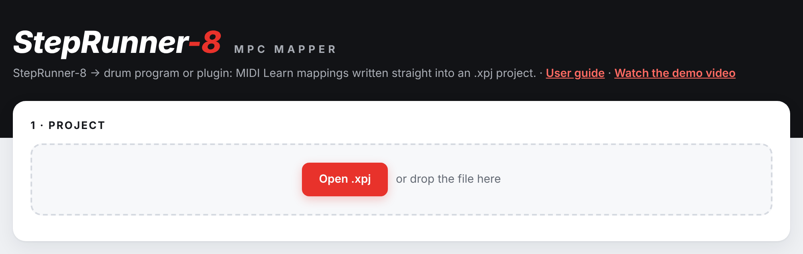
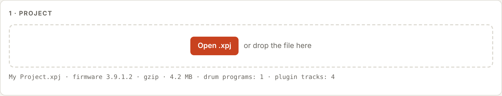
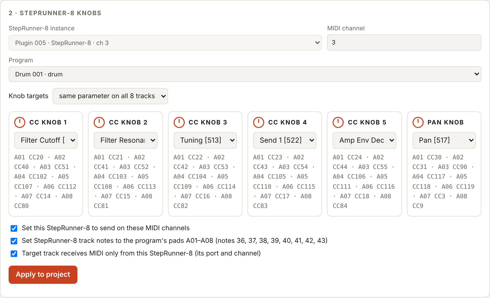
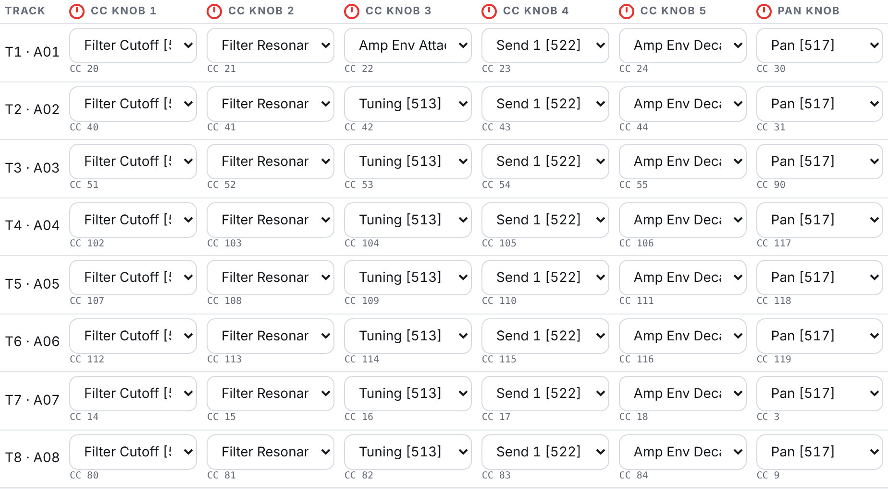
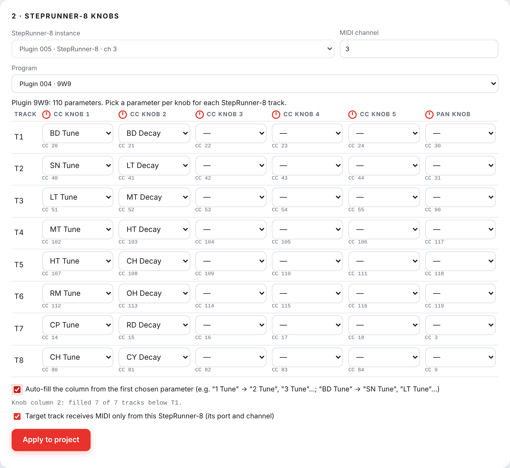
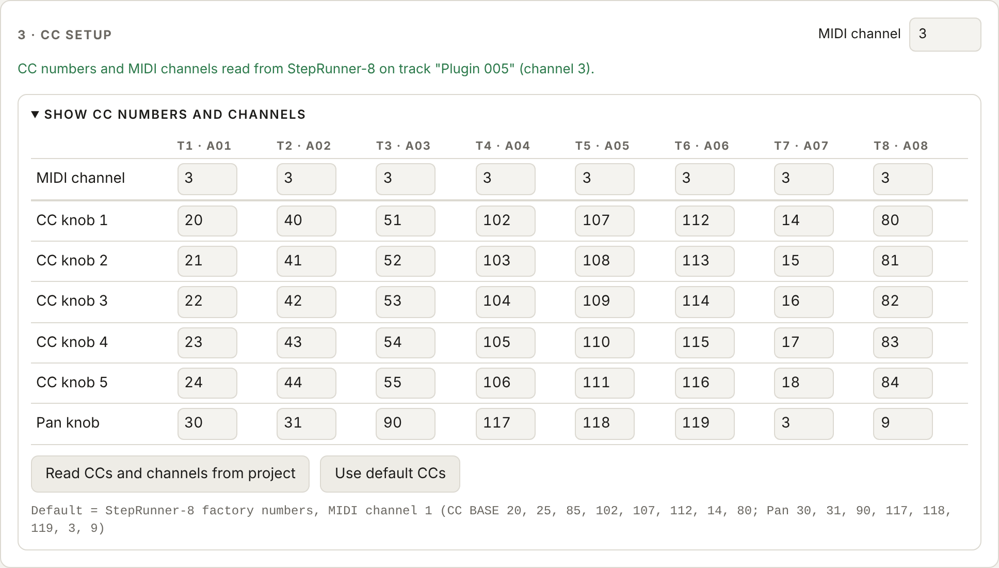
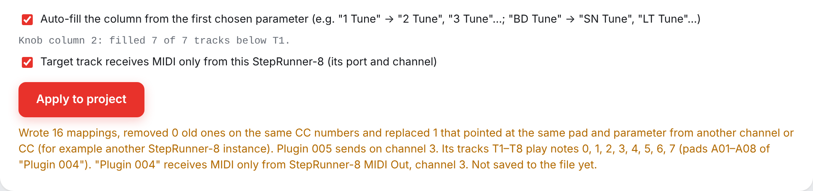
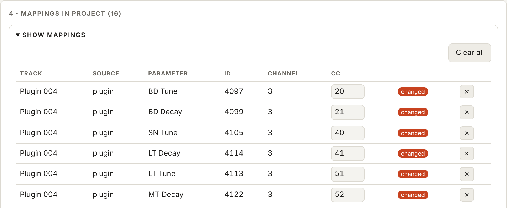

# StepRunner-8 MPC Mapper — User Guide

**StepRunner-8 MPC Mapper** is a small editor that runs in your web browser:
**[open the StepRunner-8 MPC Mapper](https://djokenzi.github.io/steprunner-8/mpcmap.html)**. Nothing to install.

It writes MIDI Learn
mappings straight into a saved MPC project (`.xpj`). With those mappings, the CC locks of StepRunner-8 control
the parameters you choose: pad parameters of a drum program or the parameters of a plugin instrument such as 9W9,
DrumSynth or TR-MPC. You do not have to map anything by hand with MIDI Learn on the MPC.

In the same step it can also set up StepRunner-8 and the target track: the MIDI channel StepRunner-8 sends on, the
notes its eight tracks play, and the target track's MIDI input.

Everything happens locally in your browser. The project is not uploaded anywhere, not even to GitHub.

> **CREATE DEFAULT MAP or the Mapper?** StepRunner-8's own **CREATE DEFAULT MAP** button (see the
> [manual](MANUAL.md#34-create-default-map)) maps a fixed set of pad parameters on a drum program. Use the Mapper when you
> want to choose the parameters yourself, control a plugin instrument, or set up several StepRunner-8 instances.

**Contents**

1. [Before you start](#1-before-you-start)
2. [Open the project](#2-open-the-project)
3. [Choose the StepRunner-8 instance and the target track](#3-choose-the-steprunner-8-instance-and-the-target-track)
4. [Mapping a drum program](#4-mapping-a-drum-program)
5. [Mapping a plugin instrument](#5-mapping-a-plugin-instrument)
6. [CC setup](#6-cc-setup)
7. [Options and Apply to project](#7-options-and-apply-to-project)
8. [Check the mappings](#8-check-the-mappings)
9. [Save](#9-save)
10. [Back on the MPC](#10-back-on-the-mpc)
11. [Notes and troubleshooting](#11-notes-and-troubleshooting)

---

## 1. Before you start

- **Browser:** Chrome or Edge on a computer is recommended. Other browsers work too, but they can only save the
  result as a downloaded file (no *Save over original*).
- **MPC firmware:** the project format was verified on MPC firmware **3.9.1.2**. Projects saved on other versions
  open with a warning; try those on a copy first.
- **The project:** on the MPC, add StepRunner-8 on a plugin track and create the track it should play (a drum
  program or a plugin instrument). **Save the project**, then copy its `.xpj` file to your computer (for example from
  the SD card or USB drive you save projects to).
- **Work on a copy.** The Mapper can download a backup automatically, but keeping your own copy of the project is
  still a good idea.

## 2. Open the project

Open the [StepRunner-8 MPC Mapper](https://djokenzi.github.io/steprunner-8/mpcmap.html) in the browser. Click **Open .xpj** and choose the project, or drag the file onto the dashed area.

When the project has loaded, a line under the button shows the file name, the firmware it was saved on and how many
drum programs and plugin tracks it has. The other sections of the page appear below.

If something is wrong (not an MPC project, an unknown format), a red message says so and the file is left untouched.

## 3. Choose the StepRunner-8 instance and the target track

At the top of section **2 · StepRunner-8 knobs**:

- **StepRunner-8 instance:** the StepRunner-8 plugin whose CCs you are mapping. The list shows each instance's
  track and MIDI channel. If the project has only one instance, it is chosen for you. If it has none, StepRunner-8's
  default CC numbers are used.
- **MIDI channel:** the channel StepRunner-8 sends on, for all eight tracks at once. It shows *mixed* when the tracks
  use different channels; you can set each track separately in [CC setup](#6-cc-setup).
- **Program:** the target track. Drum programs are marked *drum*; plugin tracks show the plugin's name
  (for example *Plugin 004 · 9W9*). StepRunner-8 tracks themselves are not listed.

The rest of the section changes with the kind of target track you pick.

## 4. Mapping a drum program

StepRunner-8 track **T1** plays pad **A01**, T2 plays A02, and so on up to T8 and A08. Each track has five CC knobs
and a pan knob, and each knob sends its own CC number.

### Same parameter on all 8 tracks

With **Knob targets: same parameter on all 8 tracks**, you get one card per knob. Pick a pad parameter for the knob,
and it is mapped on all eight pads A01–A08, each pad on its own track's CC. Under each menu you can see which CC
goes to which pad.

The **PAN KNOB** is mapped to the pad's **Pan [517]** by default. Choose *— not mapped —* to leave a knob out.

The parameter list is grouped the way the MPC shows it in MIDI Learn:

- **Mixer:** Level, Pan, Pad Mute, Pad Solo, Send 1–4
- **Track:** the pad's sound parameters (Tuning, Filter Cutoff, Filter Resonance, envelopes, layers…)
- **Not in the MPC menu for drum programs:** parameters the MPC accepts in a project but does not offer in its own
  MIDI Learn menu. They may or may not have an effect.

The number in brackets is the MPC's internal parameter ID.

### Different parameter per track

Choose **Knob targets: different parameter per track** to pick the parameter for every track and knob separately,
for example Tuning on the kick and Filter Cutoff on the hi-hat. The table starts from what the cards had.

## 5. Mapping a plugin instrument

When the target is a plugin track, you get a table with one row per StepRunner-8 track (T1–T8) and one column per knob.
Under each menu is the CC number that knob sends.

Parameter lists are built in for these plugins: **DrumSynth**, **6W6**, **8W8**, **9W9**, **Iona**, **CW-78** and
**TR-MPC**. For any other plugin, the page says there is no parameter list for it yet.

### Auto-fill

Most drum plugins have the same parameter for each of their instruments, so a column usually goes "kick tune,
snare tune, tom tune…". Tick **Auto-fill the column from the first chosen parameter** (below the table), then pick a
parameter in the first row of a column. The Mapper fills in the rows below it:

- If the name has a number, the number counts up: `Slot 1 Tune` → `Slot 2 Tune` … `Slot 8 Tune` (TR-MPC),
  `1 Tune` → `2 Tune` … (DrumSynth).
- If the name has no number, it takes the same parameter of the next instruments in the plugin's list:
  `BD Tune` → `SN Tune`, `LT Tune`, `MT Tune`… (9W9).

Auto-fill starts from the first chosen cell of a column and overwrites the cells below it. Rows where no matching
parameter is found are left empty. A line under the checkbox says how many rows were filled. Ticking the box when
columns already have a first value fills those columns at once. You can still change any cell by hand afterwards.

## 6. CC setup

Section **3 · CC setup** holds the MIDI channel and the CC numbers of every StepRunner-8 track. Click
**Show CC numbers and channels** to open the table: tracks in columns, the MIDI channel in the first row, then
CC knobs 1–5 and the pan knob.

- The numbers are **read from the chosen StepRunner-8 instance** in the project, including CC numbers you changed
  with EDIT CC. The green line above the table tells you where they came from.
- **Read CCs and channels from project** goes back to what the project has.
- **Use default CCs** sets StepRunner-8's factory numbers and MIDI channel 1.
- The **MIDI channel** field at the top right sets the channel for all tracks (the same field as in section 2).

The MPC tells mappings apart by **channel + CC number**. Two knobs may share a CC number only if they are on
different channels. If two knobs clash, their fields turn red, the table opens, and **Apply to project** stays
disabled until you fix it.

If the project has several StepRunner-8 instances on the same channel with the same CC numbers, a warning says so:
the MPC cannot tell them apart, so a mapping would react to both. Give each instance its own channel.

## 7. Options and Apply to project

Below the knobs are the options, then the **Apply to project** button.

- **Auto-fill the column…** (plugin tracks only): see [Auto-fill](#auto-fill).
- **Target track receives MIDI only from this StepRunner-8 (its port and channel):** sets the target track's MIDI
  input to StepRunner-8's port (`StepRunner-8 MIDI Out`; a second instance is `StepRunner-8 2 MIDI Out`) and to
  its channel. If the eight tracks use different channels, the input is set to all channels.

Click **Apply to project**. For every knob with a parameter, the Mapper creates a mapping from that track's channel
and CC to the chosen parameter. It also sets up the chosen StepRunner-8 instance in the project, so it matches the
mappings:

- **MIDI channels:** StepRunner-8 sends on the channels from CC setup, in the playing pattern and in all stored
  patterns and states.
- **Notes:** each StepRunner-8 track plays the note of its pad (T1 → A01 … T8 → A08) on the target track. The notes
  are read from the project. Drum programs normally use notes 36–43; plugin instruments use notes **0–7** for their
  first eight pads.

Before adding the new mappings, it removes:

- older mappings on the same target track that use the same channel and CC numbers, and
- older mappings that point at the same parameter from another channel or CC (for example from another StepRunner-8
  instance). The message turns orange when this happens, so you notice.

The message lists everything that was changed. **Nothing is written to the file until you save** (section 9), so you
can apply several times, for example once per target track.

## 8. Check the mappings

Section **4 · Mappings in project** lists all MIDI Learn mappings of the project. Click **Show mappings** to open it.

- **changed** marks mappings added or edited since the project was opened.
- **shared CC** marks mappings that use the same channel and CC as another one (one CC moving several parameters).
- You can change a mapping's **CC** number directly in the table.
- **×** deletes one mapping; **Clear all** deletes them all.

## 9. Save

- **Save over original** writes the changes back into the file you opened. It is available in Chrome and Edge when
  you opened the file with **Open .xpj** (not by dragging it).
- **Download as new file** downloads the changed project under the same name. Copy it over the project afterwards.
- **download a backup of the original first (.bak)** downloads the unchanged project as `<name>.xpj.bak` before
  saving. When downloading, the `.bak` file comes first and the changed project second. Copy the file **without**
  `.bak` to the MPC.

Only the MIDI Learn mappings, StepRunner-8's channels and notes, and the target track's MIDI input are changed.
The rest of the project is left exactly as it was.

## 10. Back on the MPC

1. Copy the saved `.xpj` back to its project folder, replacing the old file.
2. If the project is still open on the MPC, **load it again without saving it first**. Saving the open project
   would overwrite the new mappings with the MPC's old ones.
3. Press PLAY. The CC locks of StepRunner-8 now move the parameters you chose.
4. To check, open the target track's MIDI input settings: it should show the StepRunner-8 port and channel.
   The mappings are listed in the MPC's MIDI Learn screen.

## 11. Notes and troubleshooting

- **"No parameter list for plugin …"**: only the plugins listed in [section 5](#5-mapping-a-plugin-instrument) have
  built-in parameter lists.
- **Firmware warning**: the project was saved on a firmware other than 3.9.1.2. Test on a copy.
- **A knob does nothing**: check that the step actually has a CC lock, and that the right StepRunner-8 instance and
  target track were chosen when you clicked Apply.
- **Two StepRunner-8 instances move the same parameter**: they send the same CC on the same channel. Give each
  instance its own MIDI channel and apply again.
- **"Save over original" is greyed out**: the browser cannot write to files, or the file was dragged in. Use
  *Download as new file*.
